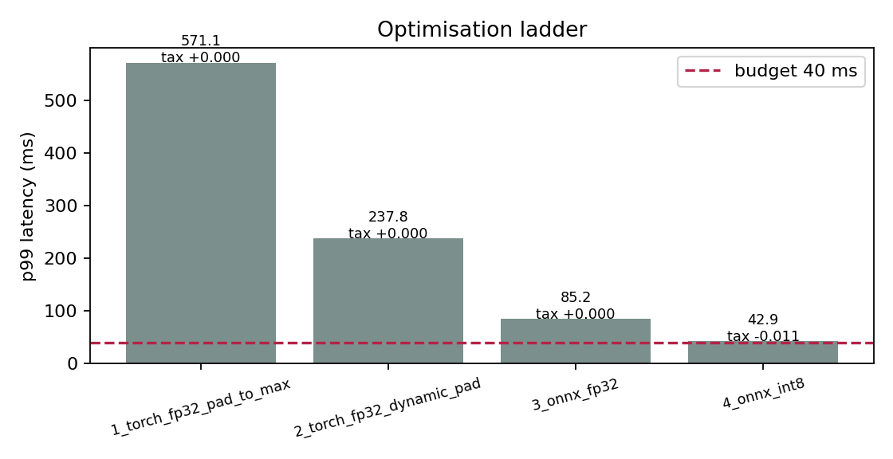
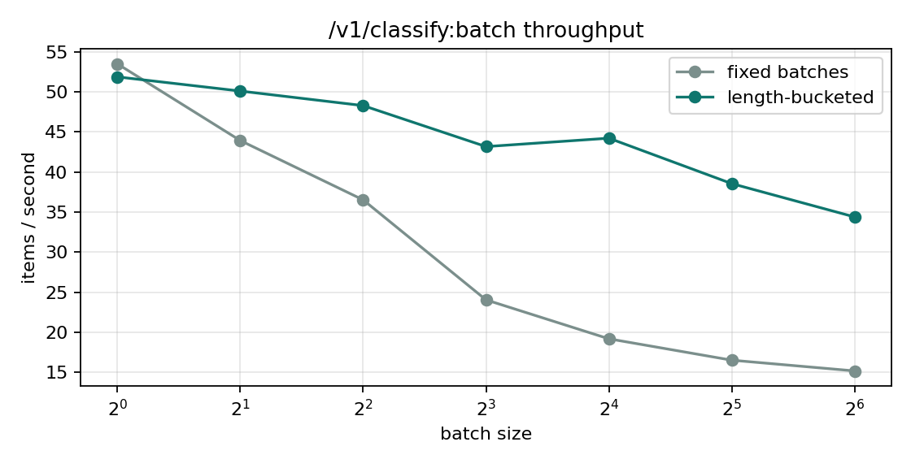

# BENCHMARKS (generated from our own runs)

Re-create with `make bench bench-batch` and `make serve` + `make load`.

## Optimisation ladder (batch size 1, CPU, 2 threads, n=300)

Reference rung for the paired accuracy tax: `2_torch_fp32_dynamic_pad`.

| Rung | p50 ms | p99 ms | macro-F1 | Paired tax vs reference [95% CI] |
|---|---|---|---|---|
| 1_torch_fp32_pad_to_max | 126.4 | 571.1 | 0.825 | +0.000 [+0.000, +0.000] |
| 2_torch_fp32_dynamic_pad | 51.7 | 237.8 | 0.825 | +0.000 [+0.000, +0.000] |
| 3_onnx_fp32 | 26.5 | 85.2 | 0.825 | +0.000 [+0.000, +0.000] |
| 4_onnx_int8 | 15.0 | 42.9 | 0.814 | -0.011 [-0.069, +0.058] |

## HTTP latency of /v1/classify

- model: `onnx-int8`, concurrency 16, 800 requests, 56 req/s
- p50 270.0 ms | p95 459.5 ms | **p99 542.3 ms** (budget 40 ms): OVER budget

## /v1/classify:batch throughput (model `onnx-int8`, 256 mixed-length messages)

| Batch size | Fixed batches (items/s) | Length-bucketed (items/s) | Pad waste fixed | Pad waste bucketed |
|---|---|---|---|---|
| 1 | 53 | 52 | 0.00 | 0.00 |
| 2 | 44 | 50 | 0.21 | 0.01 |
| 4 | 37 | 48 | 0.38 | 0.02 |
| 8 | 24 | 43 | 0.53 | 0.04 |
| 16 | 19 | 44 | 0.62 | 0.08 |
| 32 | 17 | 39 | 0.66 | 0.16 |
| 64 | 15 | 34 | 0.70 | 0.33 |

