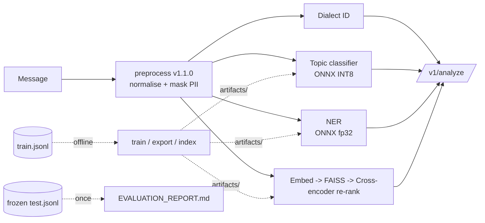

# Shifa: bilingual patient-inquiry triage

Shifa reads a patient message in **Gulf Arabic, MSA or English** and returns what a hospital call-centre agent needs:
the **topic** (appointment, billing, lab_results, prescription), the **entities** (doctor, date, department, drug, test, amount),
and **similar resolved cases**. Personal identifiers (mobile and landline numbers, MRN, national ID / iqama, email, card number, IBAN) are masked before any model sees it.

Built as the SDA-AIE-211 capstone: every lab (1 to 6) is a component, plus the extension **`/v1/classify:batch`**
(length-bucketed batching with a measured throughput curve).

> **Data.** Everything is synthetic (templates + slot values). No real patient data is used or stored (PDPL).
> Validation and test use wordings that never occur in training, so scores measure generalisation, not memorisation.
> Scores on synthetic data are not a claim about real hospital traffic.

## Architecture



| Component | Lab | Where |
|---|---|---|
| Versioned preprocessing, PII masking, skew canaries | 1 | `shifa/preprocess.py`, `tests/test_preprocess.py` |
| Tokenizer audit (fertility, UNK, p95 length) | 1 | `scripts/tokenizer_audit.py` |
| Architecture rationale for every choice | 2 | `DECISIONS.md` |
| Topic classifier + TF-IDF baseline | 3A | `scripts/train_topic.py`, `scripts/train_baseline.py` |
| NER with first-sub-token alignment | 3B | `scripts/train_ner.py`, `shifa/ner_utils.py` |
| Dialect ID and per-dialect slices | 4 | `shifa/dialect.py`, `scripts/evaluate.py` |
| FAISS + cross-encoder + recall/MRR | 5 | `scripts/build_index.py`, `shifa/search.py` |
| Slices, bootstrap CIs, behavioural tests, error taxonomy | 6 | `shifa/metrics.py`, `shifa/behaviour.py`, `scripts/evaluate.py` |
| ONNX export, INT8, ladder, HTTP p99 | 7 | `scripts/export_onnx.py`, `scripts/benchmark.py`, `scripts/load_test.py` |
| **Extension:** batch endpoint | - | `shifa/batching.py`, `shifa/serve.py`, `scripts/bench_batch.py` |

## Run it

**Fast path (laptop, no GPU, no downloads).** Serves the TF-IDF baseline, useful for the demo shell and the tests:

```bash
pip install -r requirements.txt        # or only the "core" block
make quickstart                        # data -> baseline -> dialect ID -> serve on :8000
# open http://localhost:8000/demo
make test
```

**Full pipeline (GPU for training, e.g. Colab T4).**

```bash
make all          # data baseline dialect audit train ner index export bench bench-batch eval
make serve        # startup canaries must be green; INT8 model is used if exported
make load         # in a second terminal: 16 concurrent clients, p99 over HTTP
                  # if p99 is over budget: try `make serve WORKERS=2` and SHIFA_THREADS=1, and say what you measured
make final        # the ONE time the frozen test split is opened -> EVALUATION_REPORT.md
```

On Colab: `!git clone <repo> && cd shifa-nlp && pip install -r requirements.txt && make all`, then download `artifacts/`.
Training scripts read only `train` and `val`. The test split raises `PermissionError` unless `SHIFA_FINAL=1`.

## API

| Endpoint | Purpose |
|---|---|
| `GET /v1/health` | versions, canaries, which models are loaded |
| `POST /v1/classify` | `{"text": "..."}` -> topic |
| `POST /v1/classify:batch` | `{"texts": [...], "bucket": true}` -> topics in the original order |

Input limits (in `shifa/serve.py`): each text is stripped and must be 1 to 2,000 characters, a batch holds at most 256 texts,
and a request body over 1 MB is refused with 413 before it is parsed (`SHIFA_MAX_BODY_BYTES`). The service has no
authentication: run it behind the hospital gateway, and set a body limit at the proxy as well.
| `POST /v1/analyze` | topic + dialect + entities + similar resolved cases |
| `GET /demo` | demo page |

```bash
curl -s localhost:8000/v1/analyze -H 'content-type: application/json' \
  -d '{"text":"ابي أأجل موعدي يوم الأحد، جوالي 0551234567"}'
```

## Requirement map

| Req | Target | Evidence file |
|---|---|---|
| R1 | one versioned preprocessing module, PII 100% recall on the tested formats (incl. spaced / dashed numbers, bare file numbers, landlines), no masking of amounts, dates or lab values, canaries at startup | `tests/test_preprocess.py`, `shifa/serve.py` lifespan |
| R2 | topic >= +8 macro-F1 vs TF-IDF (paired CI), NER entity-F1 >= 0.80 | `EVALUATION_REPORT.md` |
| R3 | versioned FAISS + manifest, two-stage, recall@10 >= 0.80, MRR@10 >= 0.70, cross-lingual gap | `artifacts/index/manifest.json`, `EVALUATION_REPORT.md` |
| R4 | slices + CIs, invariance >= 95%, MFT >= 90%, >= 100 hand-read errors | `EVALUATION_REPORT.md`, `reports/errors_tagged.csv` |
| R5 | p99 <= 40 ms over HTTP at 16 concurrent, full ladder with paired taxes, fp32 rollback | `BENCHMARKS.md`, `reports/http_load.json` |
| R6 | architecture-grounded rationale per model | `DECISIONS.md` |
| R7 | re-runnable scripts, frozen test untouched, BENCHMARKS from our own runs | `Makefile`, `reports/test_access.log` |

Numbers are **not** copied into this README. They are produced by the scripts and live in `EVALUATION_REPORT.md` and `BENCHMARKS.md`.

## Error taxonomy workflow (R4)

1. `make eval` writes `reports/errors_to_read.csv` (validation errors + behavioural failures).
2. Read at least 100 rows aloud, fill the `category` column (for example: dialect gap, billing vs appointment overlap, label ambiguity, PII artefact).
3. Save as `reports/errors_tagged.csv`, run `make eval` again: the histogram is added to the report. Each category becomes a costed fix and a permanent test.

## Known limits (written by hand)

- Synthetic, template-based data: scores are an indication, not a deployment claim. Dialect ID is near-perfect on it for that reason.
- Dialect ID is lexical (char n-grams), not the CAMeL Tools model from Lab 4.
- No QA model (Lab 3B in this course has no QA part), no sentiment or urgency head.
- NER strictness: one boundary miss counts as a full error.
- Slices below 50 items, or with fewer than 10 wordings, are flagged in the report because their intervals are wide.
- Validation and test each hold one wording per topic and dialect (36 wordings: 4 topics x 3 dialects x 3 held-out templates). Confidence intervals therefore resample
  wordings, not messages (cluster bootstrap), and they are wide. That width is the real size of the evidence:
  more held-out templates is the way to narrow it, not more messages from the same templates.
- PII masking is rule-based. It does not mask names that a patient writes about themself ("اسمي ..."), free-text
  addresses, or numbers written out in words. Treat it as a first line, not a guarantee.


## نشر نسخة تجريبية مباشرة (Render)

هذا الإعداد ينشر واجهة العرض `/demo` مع نموذج TF-IDF الأساسي وميزة تحديد اللهجة.
لا يتطلب رفع أوزان النماذج الكبيرة. في Render سيُبنى النموذج من بيانات التدريب والتحقق الاصطناعية أثناء البناء.

1. ارفع محتويات هذا المستودع إلى GitHub مع الحفاظ على المجلدات كما هي.
2. في Render اختر **New + → Blueprint** واربط مستودع GitHub.
3. وافق على إعداد `render.yaml` وانتظر اكتمال Build وDeploy.
4. افتح رابط الخدمة الذي ينتهي بـ `onrender.com`؛ الصفحة الرئيسية تحوّلك تلقائياً إلى `/demo`.
5. جرّب أمثلة الرسائل الاصطناعية في الواجهة.

ملاحظات:
- الخطة المجانية قد توقف الخدمة بعد فترة عدم استخدام؛ أول فتح بعدها قد يستغرق وقتاً حتى تستيقظ.
- النسخة المنشورة تستخدم نموذج TF-IDF الاحتياطي، وليست نماذج ONNX/NER/FAISS المدرّبة الكاملة.
- البيانات في هذا المشروع اصطناعية. لا تستخدم رسائل مرضى حقيقية أو معلومات شخصية.
