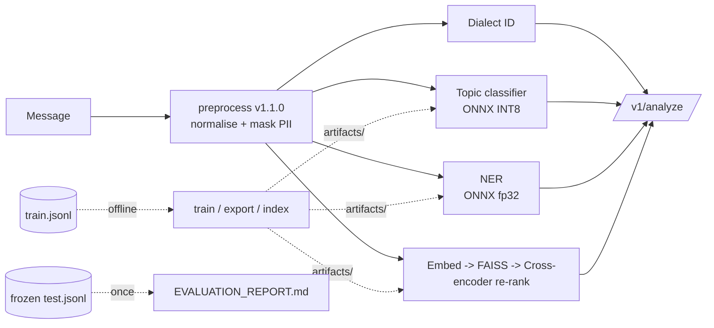
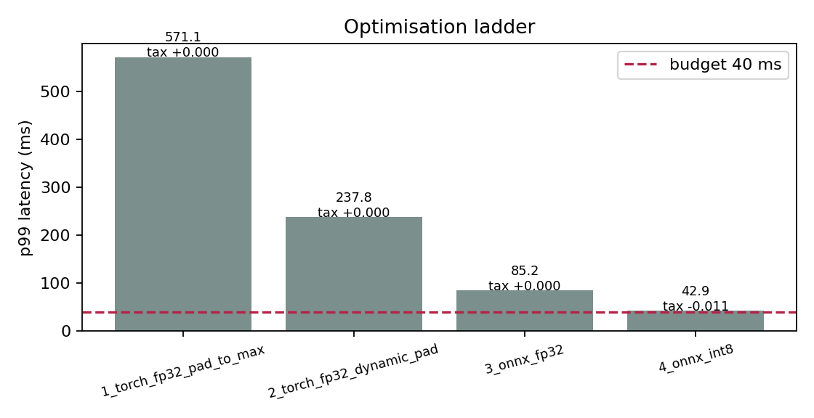
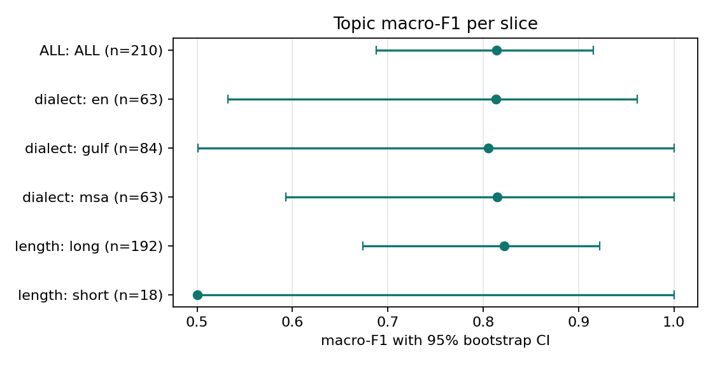
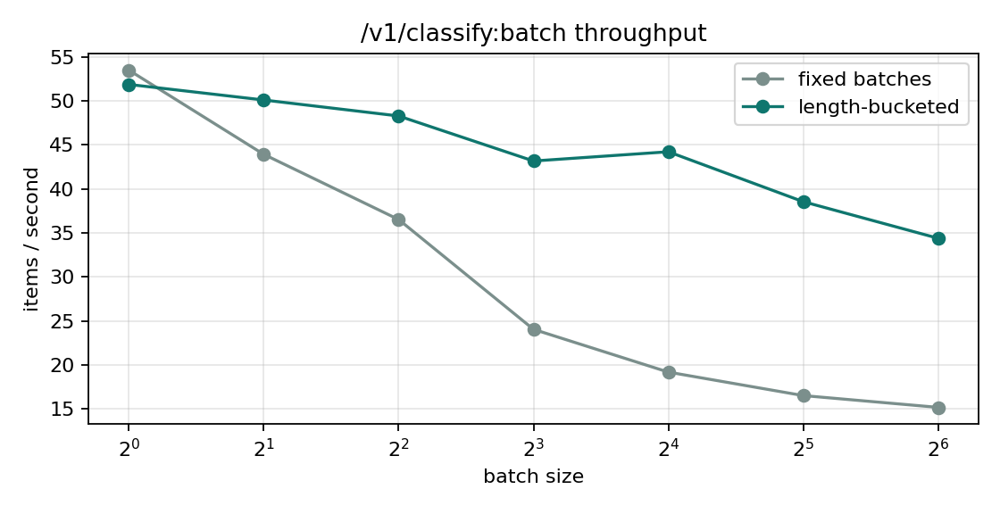

# Shifa: bilingual patient-inquiry triage

Shifa reads a patient message in **Gulf Arabic, MSA or English** and returns what a hospital call-centre agent needs:
the **topic** (appointment, billing, lab_results, prescription), the **entities** (doctor, date, department, drug, test, amount),
and **similar resolved cases**. Personal identifiers (mobile and landline numbers, MRN, national ID / iqama, email, card number, IBAN) are masked before any model sees it.

Built as the SDA-AIE-211 capstone: every lab (1 to 6) is a component, plus the extension **`/v1/classify:batch`**
(length-bucketed batching with a measured throughput curve).

> **Data.** Everything is synthetic (templates + slot values). No real patient data is used or stored (PDPL).
> Validation and test use wordings that never occur in training, so scores measure generalisation, not memorisation.
> Scores on synthetic data are not a claim about real hospital traffic.

## Architecture



| Component | Lab | Where |
|---|---|---|
| Versioned preprocessing, PII masking, skew canaries | 1 | `shifa/preprocess.py`, `tests/test_preprocess.py` |
| Tokenizer audit (fertility, UNK, p95 length) | 1 | `scripts/tokenizer_audit.py` |
| Architecture rationale for every choice | 2 | `DECISIONS.md` |
| Topic classifier + TF-IDF baseline | 3A | `scripts/train_topic.py`, `scripts/train_baseline.py` |
| NER with first-sub-token alignment | 3B | `scripts/train_ner.py`, `shifa/ner_utils.py` |
| Dialect ID and per-dialect slices | 4 | `shifa/dialect.py`, `scripts/evaluate.py` |
| FAISS + cross-encoder + recall/MRR | 5 | `scripts/build_index.py`, `shifa/search.py` |
| Slices, bootstrap CIs, behavioural tests, error taxonomy | 6 | `shifa/metrics.py`, `shifa/behaviour.py`, `scripts/evaluate.py` |
| ONNX export, INT8, ladder, HTTP p99 | 7 | `scripts/export_onnx.py`, `scripts/benchmark.py`, `scripts/load_test.py` |
| **Extension:** batch endpoint | - | `shifa/batching.py`, `shifa/serve.py`, `scripts/bench_batch.py` |

## Run it

**Fast path (laptop, no GPU, no downloads).** Serves the TF-IDF baseline, useful for the demo shell and the tests:

```bash
pip install -r requirements.txt        # or only the "core" block
make quickstart                        # data -> baseline -> dialect ID -> serve on :8000
# open http://localhost:8000/demo
make test
```

**Full pipeline (GPU for training, e.g. Colab T4).**

```bash
make all          # data baseline dialect audit train ner index export bench bench-batch eval
make serve        # startup canaries must be green; INT8 model is used if exported
make load         # in a second terminal: 16 concurrent clients, p99 over HTTP
                  # if p99 is over budget: try `make serve WORKERS=2` and SHIFA_THREADS=1, and say what you measured
make final        # the ONE time the frozen test split is opened -> EVALUATION_REPORT.md
```

On Colab: `!git clone <repo> && cd shifa-nlp && pip install -r requirements.txt && make all`, then download `artifacts/`.
Training scripts read only `train` and `val`. The test split raises `PermissionError` unless `SHIFA_FINAL=1`.

## API

| Endpoint | Purpose |
|---|---|
| `GET /v1/health` | versions, canaries, which models are loaded |
| `POST /v1/classify` | `{"text": "..."}` -> topic |
| `POST /v1/classify:batch` | `{"texts": [...], "bucket": true}` -> topics in the original order |

Input limits (in `shifa/serve.py`): each text is stripped and must be 1 to 2,000 characters, a batch holds at most 256 texts,
and a request body over 1 MB is refused with 413 before it is parsed (`SHIFA_MAX_BODY_BYTES`). The service has no
authentication: run it behind the hospital gateway, and set a body limit at the proxy as well.
| `POST /v1/analyze` | topic + dialect + entities + similar resolved cases |
| `GET /demo` | demo page |

```bash
curl -s localhost:8000/v1/analyze -H 'content-type: application/json' \
  -d '{"text":"ابي أأجل موعدي يوم الأحد، جوالي 0551234567"}'
```

## Results

The frozen test split was opened **once** (`make final`, logged in `reports/test_access.log`). The numbers below are copied from
`EVALUATION_REPORT.md` (test) and `reports/eval_val.md` (validation, used for our choices). The scripts produce them; nothing is hand-tuned.

### Final: frozen test split

| Target | Measured (test) | Status |
|---|---|---|
| NER entity-F1 >= 0.80 | 0.962 | PASS |
| recall@10 >= 0.80 | 0.900 | PASS |
| MRR@10 >= 0.70 | 0.773 | PASS |
| MFT >= 90% | 0.958 | PASS |
| Hand-read errors >= 100 | 104 | PASS |
| Invariance >= 95% | 0.941 | FAIL (weakest: swap department 0.725, swap test 0.865) |
| Topic gain over TF-IDF >= +0.08 (CI > 0) | **-0.071** [-0.150, -0.018] | **FAIL: the model is worse than the baseline** |
| p99 <= 40 ms over HTTP at 16 concurrent | 542 ms (free Colab, 2 vCPU); 42.9 ms at batch 1 | FAIL (measured on the validation run, not on test) |

**Plain reading.** On unseen wordings in this synthetic setup, our fine-tuned topic classifier does **not** beat a TF-IDF baseline:
the paired difference is negative and its 95% interval excludes zero. We do not claim otherwise. Entity extraction and retrieval pass.

### Validation (where the choices were made)

| | Validation |
|---|---|
| Topic macro-F1, served INT8 model | 0.814 [0.688, 0.915] |
| Topic macro-F1, TF-IDF baseline | 0.805 [0.666, 0.920] |
| Paired gain | +0.009 [-0.141, +0.141] |
| NER entity-F1 | 0.902 |
| recall@10 / MRR@10 | 0.757 / 0.586 |
| Invariance / MFT | 0.940 / 0.958 |

Validation and test disagree in sign on the topic gain (+0.009 vs -0.071) and on retrieval (0.757 vs 0.900 recall@10). The held-out
sets contain only 36 wordings each, so which wordings are held out moves the score a lot. That is what the wide cluster-bootstrap
intervals say, and it is the main limit of this evidence.

**What went wrong, in short.**
- *Topic gain:* a strong baseline. With 8 training templates TF-IDF already reads most wordings, and the remaining errors are intent
  overlaps (appointment vs billing: "cancelled my appointment, refund me") that neither model separates. On the test split the baseline
  is better. We have **not** found out why (candidate causes we did not test: the INT8 tax, too few training wordings, the
  checkpoint chosen on a single validation template set).
- *Invariance:* swapping a department or a test name changes the predicted topic in a quarter to a seventh of the pairs on test;
  swapping a date was the weak spot on validation (0.853). The weak kind changed between splits.
- *Latency:* the HTTP test ran on 2 shared vCPUs; the ladder shows the optimisation works (571 ms to 42.9 ms at batch 1).
- *First version:* with only 4 training templates the model memorised them (val macro-F1 0.72, NER 0.74, paired-gain CI
  [-0.15, +0.36]). Widening the generator to 14 templates per cell is what moved NER to 0.90 on validation.

**Error taxonomy** (104 validation errors read by hand): similar intent 42 (40%), sensitivity to a swap or added text 30 (29%),
short text 13 (13%), entity type confusion 9, entity boundary 6, dialect wording 4.





## Requirement map

| Req | Target | Evidence file |
|---|---|---|
| R1 | one versioned preprocessing module, PII 100% recall on the tested formats (incl. spaced / dashed numbers, bare file numbers, landlines), no masking of amounts, dates or lab values, canaries at startup | `tests/test_preprocess.py`, `shifa/serve.py` lifespan |
| R2 | topic >= +8 macro-F1 vs TF-IDF (paired CI), NER entity-F1 >= 0.80 | `EVALUATION_REPORT.md` |
| R3 | versioned FAISS + manifest, two-stage, recall@10 >= 0.80, MRR@10 >= 0.70, cross-lingual gap | `artifacts/index/manifest.json`, `EVALUATION_REPORT.md` |
| R4 | slices + CIs, invariance >= 95%, MFT >= 90%, >= 100 hand-read errors | `EVALUATION_REPORT.md`, `reports/errors_tagged.csv` |
| R5 | p99 <= 40 ms over HTTP at 16 concurrent, full ladder with paired taxes, fp32 rollback | `BENCHMARKS.md`, `reports/http_load.json` |
| R6 | architecture-grounded rationale per model | `DECISIONS.md` |
| R7 | re-runnable scripts, frozen test untouched, BENCHMARKS from our own runs | `Makefile`, `reports/test_access.log` |

Numbers in the snapshot above are copied from the scripts' output. The scripts produce `EVALUATION_REPORT.md` and `BENCHMARKS.md`; those files are the source of truth.

## Error taxonomy workflow (R4)

1. `make eval` writes `reports/errors_to_read.csv` (validation errors + behavioural failures).
2. Read at least 100 rows aloud, fill the `category` column (for example: dialect gap, billing vs appointment overlap, label ambiguity, PII artefact).
3. Save as `reports/errors_tagged.csv`, run `make eval` again: the histogram is added to the report. Each category becomes a costed fix and a permanent test.

## Known limits (written by hand)

- Synthetic, template-based data: scores are an indication, not a deployment claim. Dialect ID is near-perfect on it for that reason.
- Dialect ID is lexical (char n-grams), not the CAMeL Tools model from Lab 4.
- No QA model (Lab 3B in this course has no QA part), no sentiment or urgency head.
- NER strictness: one boundary miss counts as a full error.
- Slices below 50 items, or with fewer than 10 wordings, are flagged in the report because their intervals are wide.
- Validation and test each hold one wording per topic and dialect (36 wordings: 4 topics x 3 dialects x 3 held-out templates). Confidence intervals therefore resample
  wordings, not messages (cluster bootstrap), and they are wide. That width is the real size of the evidence:
  more held-out templates is the way to narrow it, not more messages from the same templates.
- PII masking is rule-based. It does not mask names that a patient writes about themself ("اسمي ..."), free-text
  addresses, or numbers written out in words. Treat it as a first line, not a guarantee.
